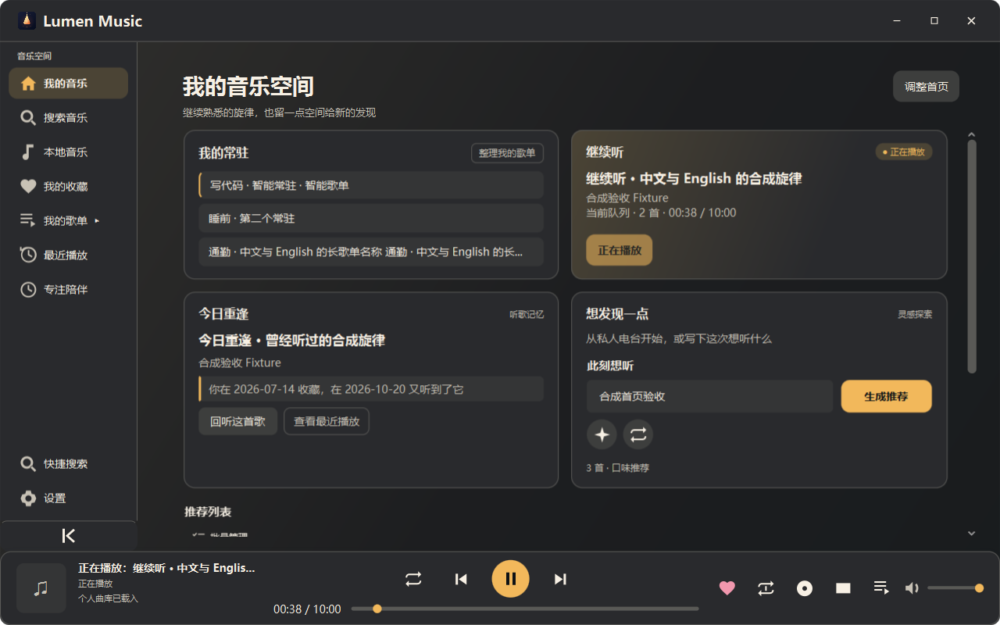
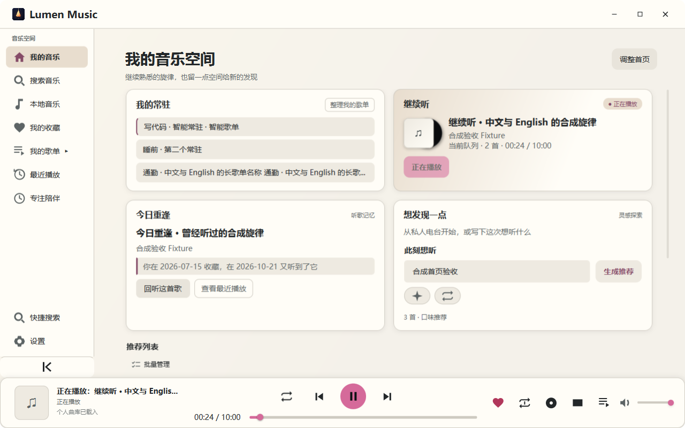

# Lumen Music

**打开就能继续自己的音乐。**

面向 Windows 的个人音乐播放器，将本地曲库、收藏歌单、沉浸歌词与听歌记忆放在一起。首页接着听，桌面轻松听，也可以把喜欢的一段反复听。

[开始使用](#开始使用) · [功能](#你可以用-lumen-做什么) · [开发](#从源码开始) · [文档](docs/README.md) · [反馈](https://github.com/Redemption505/Lumen-Music/issues/new/choose)

**Windows 10/11 x64 · v0.2.2 内测候选 · [GPLv3](LICENSE.txt)**

[工程检查](https://github.com/Redemption505/Lumen-Music/actions/workflows/verify.yml) · [版本变化](CHANGELOG.md) · [当前候选与验收范围](docs/PHASE4_RELEASE_CANDIDATE.md)



<details>
<summary>查看浅色主题</summary>



</details>

截图来自真实应用窗口，使用隔离的合成曲库；歌名、歌单和记录均为演示资料。

## 你可以用 Lumen 做什么

| 场景 | 已有能力 |
| --- | --- |
| 打开就继续听 | 恢复上次队列和位置，常驻喜欢的普通或智能歌单，按日期回听；恢复后保持暂停，由你决定何时播放 |
| 整理自己的曲库 | 导入文件或整个文件夹，包含子目录并去重；按文件夹筛选、搜索，读取内嵌封面与歌词 |
| 让收藏更有个人味道 | 歌单封面与说明、歌曲版本偏好、私人备注、歌词收藏和最近播放 |
| 专心听一首歌 | 大封面与同步歌词、手动匹配和校准、歌词定位、变速与 A–B 循环 |
| 把一段音乐留下来 | 多 P 连播、单个长视频的片段边界与合集批量整理 |
| 在桌面随手控制 | 迷你播放器、桌宠歌词、任务栏控制与沉浸页共享播放状态 |
| 调整到喜欢的样子 | 五种 Lumen 主题、浅色/深色、背景图与动态封面，支持减少动态效果 |

在线搜索、歌词、发现和可选 AI 扩展了本地听歌体验。在线能力依赖对应来源可用性；AI 需自行启用并配置，日常本地播放不需要 API Key。详细行为见[功能文档](docs/README.md#使用者)。

## 开始使用

当前仓库提供源码，**尚无公开二进制 Release**。v0.2.2 已完成本机安装、原资料恢复和五次原生启动/退出验收；独立朋友电脑及原闪退者复测仍待完成。安装候选的构建号、实际交付位置和限制集中在[候选说明](docs/PHASE4_RELEASE_CANDIDATE.md)。

如果你已经收到内测包：

1. 解压完整包，运行其中的 `LumenMusic-0.2.2-Setup.exe`。内置 Java、Python 和 VLC，无需另装开发工具。
2. 打开“本地音乐”，导入文件或文件夹，双击歌曲播放；点击红心收藏，点击底部封面进入沉浸页。
3. 在“设置 → 数据与隐私”导出数据备份；更新前先看[Windows 使用指南](docs/WINDOWS_GUIDE.md)。

首次安装和已有 v0.2.2 的同版本升级使用完整安装器；v0.2.1 增量包仅适用其清单声明的基线。**可移植备份不包含原音频和全部本机状态**，换电脑时需另行保存音频，详见[备份范围](docs/BACKUP_FORMAT.md)。

## 从源码开始

Windows 开发需准备完整 **JDK 21（推荐）** 和 **Python 3.10+**，配置 `JAVA_HOME`、`LUMEN_PYTHON` 或可用的 `PATH`。Maven 使用仓库自带 Wrapper；Python 服务仅依赖标准库。访问私有仓库需要相应 GitHub 权限。

在 PowerShell 中克隆，然后运行不打开播放器窗口的隔离协议检查：

```powershell
git clone https://github.com/Redemption505/Lumen-Music.git
cd Lumen-Music
./scripts/check.ps1 -Component Demo
```

首次运行会下载声明的 Maven 依赖。检查使用独立资料，验证 Java 与 Python 的真实 HTTP/XML 通信；它不等于窗口和音频验收。

接下来：

- **启动开发窗口：** 按[开发与复现](docs/DEVELOPMENT.md#2-从源码启动)编译、准备独立资料并运行离线 `demo`。
- **构建完整播放器：** 准备 Rust/Cargo 构建侧车；Windows 原生播放需要 x64 VLC。参数与工具要求见[开发环境](docs/DEVELOPMENT.md#1-先决条件)。
- **运行回归：** `./scripts/check.ps1` 检查 Python、Rust、Java 和 demo；可用 `-Component` 选择受影响部分，完整缓存已有时才使用 `-Offline`。

## 项目结构

```text
Lumen-Music/
├─ desktop/       JavaFX 界面、播放状态、音频与 Windows 集成
├─ service/       Python HTTP 服务、来源适配与个人资料
├─ stream-proxy/  Rust / Axum 音频转发
├─ scripts/       启动、检查、场景验收与打包入口
├─ release/       安装器资源、发行模板和第三方许可
├─ docs/          使用说明、架构、接口与验收文档
└─ .github/       CI、Issue 表单与 PR 模板
```

Java 桌面端通过本机 HTTP/XML 调用 Python 服务；Rust 侧车处理音频字节和 Range 请求。主窗口、沉浸页与迷你窗口复用播放状态，启动器管理自有服务的生命周期。

架构中的重点是快速切歌时拒绝迟到结果、将文件与网络工作移出界面线程，以及持久化失败时保留原资料。具体边界见[架构](docs/ARCHITECTURE.md)、[接口契约](docs/API.md)和[贡献指南](CONTRIBUTING.md)。

## 常见问题

**支持 Android、macOS 或 Linux 吗？**

当前桌面交付目标是 Windows 10/11 x64。Linux CI 用于工程检查；其他桌面平台未完成发行验收，Android 工作暂停，路线见[第四阶段](第四阶段.md)。

**在线搜索或歌词失败，会影响本地音乐吗？**

本地音乐有独立入口。在线来源可能失败或没有对应歌词，可以使用本地歌词、手动匹配与校准；启动问题按[故障反馈说明](docs/WINDOWS_GUIDE.md#启动失败与反馈)记录。

**我的资料保存在哪里？**

正常安装使用 `%LOCALAPPDATA%/Lumen Music` 和 `%APPDATA%/Lumen Music`。移除本地列表条目不会删除原音频；升级、卸载及备份的范围见[使用指南](docs/WINDOWS_GUIDE.md)。开发测试应使用独立资料。

## 反馈与贡献

[报告问题](https://github.com/Redemption505/Lumen-Music/issues/new?template=bug_report.yml) · [提出建议](https://github.com/Redemption505/Lumen-Music/issues/new?template=feature_request.yml) · [参与开发](CONTRIBUTING.md)

反馈时附版本与完整构建号、系统、复现步骤和预期/实际结果。诊断文件分享前先检查内容，避免附上曲库备份、Cookie、API Key 或完整私人日志。

PR 请说明具体问题、最终行为、验证结果和未测范围。编辑约定由 [.editorconfig](.editorconfig) 提供，模块与数据约束见 [AGENTS.md](AGENTS.md)。完整入口集中在[文档导航](docs/README.md)。

## 许可与致谢

Lumen 应用源码采用 [GNU GPL v3](LICENSE.txt)，第三方组件保留各自许可证。在线来源涉及 B 站、LRCLIB 与网易云补充歌词，其接口、内容和部分二进制材料的实际未决项见[第三方核对](docs/THIRD_PARTY_REVIEW.md)；可选 AI 的发送范围见[AI 设置](docs/AI_INTENT.md)。

感谢 OpenJFX、Python、Rust、Axum、VideoLAN / libVLC、vlcj、JNA 与 LRCLIB。早期产品设计参考 [Bili Music](https://github.com/Jmiao11/bili-music)；仓库文档组织另参考 [FreeTube](https://github.com/FreeTubeApp/FreeTube) 和 [TrafficMonitor](https://github.com/zhongyang219/TrafficMonitor)。
