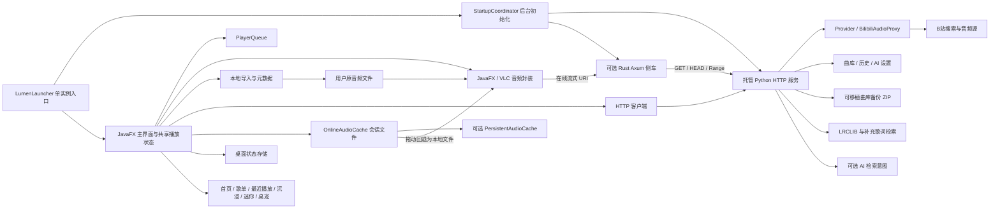

# 架构与职责

更新：2026-10-08。描述当前 v0.2.2 桌面源码；已安装及发行基线仍为 `lumen-0.2.2-20261007.4`。增量审计与冻结范围见[第四阶段 A](PHASE4_AUDIT_SCOPE.md)，本轮开发环境修复及运行证据见[第四阶段 B](PHASE4_CORE_ACCEPTANCE.md)。

## 当前结构

默认服务与侧车分别使用 `127.0.0.1:8765`、`127.0.0.1:8766`。Java 与 Python 的业务协议为本机 HTTP/XML；Rust 只转发音频字节和 Range，不保存个人曲库。在线服务不可用时，本地文件加载不等待 Python 初始化；FLAC 等格式仍需要可用的 VLC 引擎。

## 启动、线程与资源所有权

[LumenLauncher](../desktop/src/main/java/com/lumenmusic/LumenLauncher.java) 获取个人状态目录下的单实例锁并进入 JavaFX。主窗口显示后才请求 [StartupCoordinator](../desktop/src/main/java/com/lumenmusic/StartupCoordinator.java) 初始化服务；失败保留重试入口。直接从源码运行 JavaFX 的入口可使用已有外部服务，因此与安装版托管入口的前提不同。

`ManagedPythonService`、`ManagedStreamProxy` 优先复用符合健康检查的服务。只有本次创建的 `Process` 才由应用关闭；复用实例不按端口或名称终止。启动被取消后迟到的资源会释放，已经接管的服务在独立关闭线程释放。窗口、音频、任务栏按钮、热键、临时缓存及桌宠由桌面应用统一管理。

JavaFX 线程管理视图和播放协调；网络、元数据读取、导入、下载及歌词保存使用后台任务。结果经 `Platform.runLater` 应用，播放加载版本、歌词读取版本、搜索/推荐版本分别拒绝旧结果。两种音频封装还检查媒体身份和版本；结束事件不会重复推进同一加载版本。

退出先标记 `closing`、保存当前或待定位的播放快照、结束听歌采样并使旧回调失效，取消网络任务和关闭附属窗口，然后停止并释放音频。听歌报告、排队的本地列表/歌词写入与下载终止的限时等待交给非守护关闭线程，避免这些队列占用界面线程；超时会取消任务并记录固定 `SHUTDOWN_ERROR`。该线程完成缓存清理后结束，运行时协调器继续只回收自有进程。音频封装仍按 JavaFX 线程约束释放；受控响应测量不能保证任何设备故障下的原生释放耗时。

## 桌面模块

| 模块 | 当前职责 |
| --- | --- |
| `LumenFxApp` | 页面、共享播放状态、异步结果与持久化的应用协调；必要拆分绑定具体行为问题 |
| `Track`、`SegmentTimeline` | 曲目身份、来源、BV/分 P、本地 URI、片段边界；不自动将 UP 主当作演唱者 |
| `PlayerQueue` | 曲目/来源快照、当前索引、手动安排与电台优先关系；循环关闭、列表循环、单曲循环、随机四种模式 |
| `JavaFxAudioPlayer`、`VlcAudioPlayer` | 加载、暂停、拖动、状态回调和媒体释放；VLC 支持在线流式播放及本地扩展格式 |
| `MusicClient`、`LibraryClient` 等 | 服务协议、超时与错误解析；下载取消同时中断请求并关闭读取流 |
| `OnlineAudioCache` | 私有会话内的完整音轨文件，供拖动回退和复用；取消不提交半文件，退出清理 |
| `PersistentAudioCache` | 默认关闭的完整音轨缓存，管理容量、重启复用和清空；不等同收藏元数据 |
| `LocalMusicStore`、本地元数据读取 | 持久保存导入列表和文件引用，读取内嵌封面/歌词；移除列表条目不删除原音频 |
| `PlaybackStateStore` | 保存暂停恢复的队列、索引、位置等；应用启动不自动发声 |
| `LyricsSelectionStore`、`LyricsClient` | 已选歌词、偏移与片段起点及在线候选；手动记录优先，损坏反馈可见，保存前保留损坏原件的精确 `.corrupt` 副本，无法安全保留时拒绝覆盖 |
| `AppearancePreferencesStore` | 沿用普通 properties 格式；损坏转义采用默认值并保留原字节副本，同目录原子替换；读取/保留失败时不覆盖旧文件 |
| `ListeningReporter` | 后台按序报告实际播放、暂停、拖动与结束采样；退出时的最多三秒等待由关闭线程承担 |
| `ThemeController`、`UiMotion` | 深色、浅色、背景图、动态封面、Lumen 五主题，共用颜色角色和减少动态效果规则 |
| 首页、歌单展示、最近播放 | 复用曲库、版本、历史及首页偏好，展示个人内容；不建立第二套音频状态 |
| 沉浸页、迷你窗口、`PetCompanion` | 共享播放/收藏动作与歌词；桌面浮动桌宠由应用退出统一关闭 |
| `WindowsTaskbarControls`、热键 | Windows 原生控制接入，事件转回 JavaFX，并按窗口/应用生命周期释放 |
| `DiagnosticLog`、更新工具 | 固定代码诊断与明确构建身份的本地更新；诊断 ZIP 不收集完整个人资料 |

在线播放通常经 VLC 流式读取；侧车失败时使用 Python 音频代理。无法可靠拖动时，准备完整会话文件交给 JavaFX，沿用暂停/播放意图。停止旧音频前保存相对曲目的目标秒数，下载中和完整文件尚未 READY 时均用该目标保存状态；迟到结果须通过加载版本及 `closing` 检查。重启仅恢复曲目和位置，不自动发声。

## Python 服务与个人数据

服务只使用 Python 标准库。`server.py` 分派协议；Provider 获取候选；`discovery.py` 本地重排；`BilibiliAudioProxy` 解析并代理音频。B 站元数据缓存有期限和数量上限，失败不缓存；网络请求不持有曲库数据锁。

`LibraryStore` 保存收藏、普通/智能歌单、标签、版本偏好、首页布局及展示元数据；`HistoryRuntime` 核实实际采样后交给 `HistoryStore` 保存，供最近播放和推荐使用。主文件成功替换后才更新内存；损坏或外部修改不会被无声覆盖。HTTP 层用数据锁协调曲库、历史及恢复，恢复成功后重新建立对应 Store。

`AiSettingsStore` 将配置和密钥分别保存在 `ai-settings.json`、`ai-secret.json`，用同目录原子恢复记录保护组合提交。文件/环境密钥绑定完整目标地址，HTTP 备份恢复固定旧密钥目标；读取接口只返回密钥是否可用于当前地址。AI 启用且配置/密钥有效时才生成推荐检索意图，失败退回本地检索。服务写入校验本机 Host/端口、有值的 Origin 和 XML 类型；不将本机监听视作账户认证。详见[AI 操作说明](AI_INTENT.md)。

`lyrics.py` 以 LRCLIB 为主要来源并补充网易云检索；自动选择核对标题里的曲名/歌手、同步歌词与不超过五秒的时长差，华语候选优先简体。现场、翻唱等风险标题保留手动选择。来源可用性和使用条件需在交付阶段分别核对。

| Windows 默认位置 | 内容与边界 |
| --- | --- |
| `%LOCALAPPDATA%/LumenMusic` | 程序安装目录；与带空格的个人数据目录不同 |
| `%LOCALAPPDATA%/Lumen Music` | 曲库、历史、本地列表、播放状态、歌词选择、缓存、AI 配置/独立密钥及诊断记录等 |
| `%APPDATA%/Lumen Music/preferences.properties` | 外观、桌宠、布局和部分播放选项；普通 properties 与同目录原子替换，损坏原字节留在 `.damaged-*.bak` |
| `%LOCALAPPDATA%/Lumen Music/service.log` | 托管 Python/侧车原始输出；不享有诊断 ZIP 的字段白名单 |

源码测试可通过已有环境变量指定独立目录。路径覆盖规则由各 Store 决定，不能假定只改曲库变量即可隔离所有偏好和进程日志。

[可移植备份 ZIP](BACKUP_FORMAT.md) 保存曲库以及可选历史、白名单 AI 设置、背景图，不包含密钥和音频缓存，也不包含独立的本地导入列表、播放状态、歌词选择或整份外观偏好。曲库中的本地媒体引用仍会随收藏/歌单保存，ZIP 不复制原音频文件。恢复前完整预检，替换失败回滚；回滚失败保留原件副本。

安装验收的整目录备份脚本另行复制安装目录、Local/Roaming 资料，可能包含凭据和全部私人数据；不能当作可公开诊断。诊断 ZIP 只含版本、平台、状态/开关及最近二十条固定错误代码和时间；普通日志、备份与诊断是不同的交付对象。

## 开发与 Windows 交付

源码运行的前提是 JDK、Python；Rust 仅在构建侧车时需要。Maven wrapper、Cargo.lock 及基本测试入口已有。当前 Windows 发行包内置 Java runtime 23.0.2、Python 3.13.15、VLC 3.0.23、服务源码和 Rust 可执行文件；用户基础收听不需要另装开发工具。

Windows 打包另需 `jpackage`、WiX 3.14.1，以及编译安装器自定义 DLL 的 MSVC x64 C++ 工具链和 Windows SDK。POM 编译目标 17、Linux CI 的 JDK 21、实际发行 runtime 23.0.2 是不同维度。确切依赖、打包清单差异及入口前提见[审计矩阵](PHASE4_AUDIT_SCOPE.md)。

现有 CI 运行 Linux 的 Java/Python/Rust 与 demo 服务契约，不覆盖 Windows 窗口、VLC、安装/升级/卸载和归档一致性。推荐启动/检查及明确镜像的场景入口见[开发与复现](DEVELOPMENT.md)。B/C 的开发与隔离界面验收、旧安装/归档分别记录，见[C 交付验收](PHASE4_DELIVERY_ACCEPTANCE.md)；当前源码目录尚未建立 Git 历史，修改前的私有源码快照保留。后续按[第四阶段](../第四阶段.md)的 D～E 推进。
